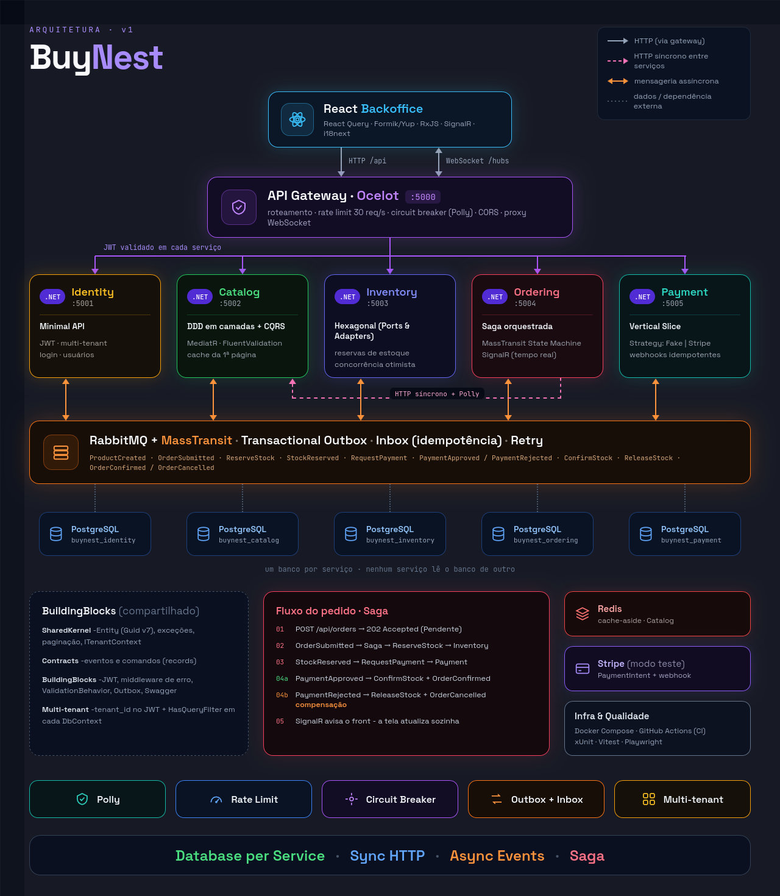

# 🪺 BuyNest

Plataforma de e-commerce em **microserviços** com backoffice web para gestão de **catálogo**, **estoque**, **pedidos** e
**pagamentos**: multi-tenant, com processamento de pedidos por saga e acompanhamento em tempo real.



| Camada | Stack |
|---|---|
| Backend | .NET 10 · ASP.NET Core · EF Core + PostgreSQL · MediatR (CQRS) · FluentValidation · MassTransit + RabbitMQ (Outbox/Saga) · Redis · SignalR · Ocelot · Polly · Stripe |
| Frontend | React 18 · TypeScript · Vite · Ant Design · React Query · Formik + Yup · RxJS · SignalR · i18next (pt-BR / en-US) |
| Qualidade | xUnit · MassTransit Test Harness · Vitest + Testing Library · Playwright · ESLint/Prettier |
| Infra | Docker · Docker Compose |

---

## Sumário

1. [Funcionalidades](#1-funcionalidades)
2. [Arquitetura](#2-arquitetura)
3. [Como rodar](#3-como-rodar)
4. [Configuração](#4-configuração)
5. [Pagamentos](#5-pagamentos)
6. [Testes](#6-testes)
7. [Estrutura do repositório](#7-estrutura-do-repositório)
   
---

## 1. Funcionalidades

- **Cadastro e multi-tenant**: cada empresa se cadastra e quem cria a conta vira o administrador. O JWT carrega o
  `tenant_id` e todos os serviços filtram os dados por ele: uma empresa nunca vê dados de outra.
- **Catálogo**: produtos com SKU único por empresa, bloqueio/desbloqueio, histórico de status e listagem paginada com
  cache no Redis.
- **Estoque**: saldo, reservas e movimentações (entrada, saída, ajuste), com alerta de estoque mínimo.
- **Pedidos**: criação assíncrona (`202 Accepted`) orquestrada por uma saga, com **linha do tempo ao vivo** de cada
  passo (estoque reservado, cobrança, pagamento, confirmação ou compensação).
- **Pagamentos**: cartão (Stripe em modo teste ou provedor simulado) e Pix, com webhooks idempotentes.
- **Backoffice**: painel com indicadores, notificações em tempo real, proteção contra saída com alterações não salvas
  e interface em português e inglês.

---

## 2. Arquitetura

| Serviço | Porta local | Responsabilidade | Estilo |
|---|---|---|---|
| **Gateway** | 5000 | Entrada única, roteamento, rate limit, circuit breaker e proxy de WebSocket | Ocelot |
| **Identity** | 5001 | Cadastro de empresas, login (JWT) e usuários | Minimal API |
| **Catalog** | 5002 | Produtos e status | DDD em camadas + CQRS |
| **Inventory** | 5003 | Saldo, reservas e movimentações | Hexagonal (Ports & Adapters) |
| **Ordering** | 5004 | Pedidos, saga e tempo real (SignalR) | Camadas leves + saga orquestrada |
| **Payment** | 5005 | Cobranças e webhooks | Vertical Slice |

Princípios:

- **Um banco por serviço** (`buynest_identity`, `buynest_catalog`...): nenhum serviço lê o banco de outro.
- **HTTP síncrono** só quando a resposta é necessária na hora (o Ordering busca o preço oficial no Catalog, com Polly).
- **Eventos assíncronos** no RabbitMQ para o resto, com **Transactional Outbox** e **Inbox** (o mesmo evento nunca é
  processado duas vezes).

### Fluxo de um pedido

```
POST /api/orders  → 202 Accepted (pedido "Pendente")
   Ordering - OrderSubmitted ──► Saga - ReserveStock ──► Inventory
                                    ◄── StockReserved -
                                - RequestPayment ──► Payment ──► Provedor (HTTP + Polly)
                                    ◄── PaymentApproved - ⇒ ConfirmStock + OrderConfirmed
                                    ◄── PaymentRejected - ⇒ ReleaseStock + OrderCancelled  (compensação)
   Ordering - SignalR ──► o backoffice atualiza a tela sozinho
```

Se faltar estoque ou o pagamento for recusado, a saga **compensa**: devolve a reserva e cancela o pedido.

---

## 3. Como rodar

**Pré-requisitos:** Docker com Compose v2+. Para rodar fora do Docker: .NET SDK 10 e Node.js 20+.
As portas `5432`, `5672`, `15672`, `6379`, `5000` e `3000` precisam estar livres.

### Opção A: tudo no Docker

```bash
cp .env.example .env          # opcional: os valores padrão já funcionam
docker compose up -d --build
```

| O quê | URL |
|---|---|
| Backoffice | http://localhost:3000 |
| API Gateway | http://localhost:5000 |
| RabbitMQ Management | http://localhost:15672 (guest/guest) |

Não há usuário pré-cadastrado: na tela de login, clique em **Cadastre sua empresa**.

```bash
docker compose logs -f ordering-api   # logs de um serviço
docker compose down                   # para tudo (-v também apaga os dados do Postgres)
```

### Opção B: infraestrutura no Docker e serviços locais (debug)

```bash
docker compose -f docker-compose.infra.yml up -d    # Postgres, RabbitMQ, Redis

# backend: um terminal por serviço (ou "Multiple startup projects" no Visual Studio/Rider)
cd backend
dotnet run --project src/Services/Identity/Buynest.Identity.Api     # :5001
dotnet run --project src/Services/Catalog/Buynest.Catalog.Api       # :5002
dotnet run --project src/Services/Inventory/Buynest.Inventory.Api   # :5003
dotnet run --project src/Services/Ordering/Buynest.Ordering.Api     # :5004
dotnet run --project src/Services/Payment/Buynest.Payment.Api       # :5005
dotnet run --project src/Gateway/Buynest.Gateway                    # :5000

# frontend
cd frontend && npm install && npm run dev                           # :5173
```

Cada API expõe **Swagger** em `http://localhost:500X/swagger`.

### Acompanhando o que acontece

- **Tela do pedido**: a linha do tempo mostra cada passo da saga assim que ele acontece.
- **Logs**: `docker compose logs -f ordering-api inventory-api payment-api`
- **Mensagens**: RabbitMQ Management → aba *Queues*.

---

## 4. Configuração

Variáveis do `.env` na raiz (lido pelo Docker Compose; veja `.env.example`). Com `dotnet run`, use
`dotnet user-secrets` com as chaves equivalentes.

| Variável | Chave .NET | Padrão | Descrição |
|---|---|---|---|
| `JWT_KEY` | `Jwt:Key` | chave de desenvolvimento | Assinatura do JWT (mín. 32 caracteres). **Troque fora do ambiente local.** |
| `PAYMENT_PROVIDER` | `PaymentGateway:Provider` | `Fake` | `Fake` (simulador) ou `Stripe` |
| `STRIPE_SECRET_KEY` | `Stripe:SecretKey` | vazio | Secret key do Stripe em modo teste (`sk_test_...`) |
| `STRIPE_WEBHOOK_SECRET` | `Stripe:WebhookSecret` | vazio | Segredo de assinatura dos webhooks (`whsec_...`) |

No frontend, `frontend/.env` define `VITE_GATEWAY_URL` (padrão `http://localhost:5000`), usado pelo proxy do Vite.

> ⚠️ Segredos ficam no `.env` (fora do Git) ou em `user-secrets`. Nunca coloque chaves em `appsettings.json`.

---

## 5. Pagamentos

O provedor é escolhido por configuração (`PaymentGateway:Provider`):

| Provedor | Uso | Comportamento |
|---|---|---|
| `Fake` (padrão) | desenvolvimento offline | falha 25% das chamadas (exercita o Polly), recusa valores acima de R$ 5.000 e cartões "Declined" |
| `Stripe` | integração real em **modo teste** | cria um **PaymentIntent** e recebe o resultado por **webhook assinado** |

Garantias:

- O número do cartão **nunca** passa pelo backend: o frontend envia só um `PaymentMethod` (`pm_...`).
- Cada cobrança usa uma **IdempotencyKey**: um retry nunca cobra duas vezes.
- Os webhooks validam a **assinatura** (`Stripe-Signature`) e são **idempotentes** (cada evento é processado uma vez).

### Habilitando o Stripe

1. Crie uma conta em https://dashboard.stripe.com, ative o **Test mode** e copie a *Secret key* (`sk_test_...`).
2. Suba com o encaminhador de webhooks:
   ```bash
   cp .env.example .env              # PAYMENT_PROVIDER=Stripe e STRIPE_SECRET_KEY=sk_test_...
   docker compose --profile stripe up -d --build
   docker compose logs stripe-cli    # copie o "whsec_..." para STRIPE_WEBHOOK_SECRET no .env
   docker compose up -d payment-api  # recria o Payment com o segredo do webhook
   ```
3. Crie um pedido no **cartão** escolhendo um cartão de teste (aprovado, recusado, saldo insuficiente ou expirado).

O `stripe-cli` encaminha os eventos para `gateway:8080/api/v1/webhooks/stripe`.

---

## 6. Testes

```bash
cd backend  && dotnet test Buynest.slnx    # domínio, saga e regras de arquitetura
cd frontend && npm test                    # unitários e de componente (Vitest)
cd frontend && npm run e2e                 # Playwright (requer o sistema no ar)
cd frontend && npm run i18n:check          # mesmas chaves em pt-BR e en-US
cd frontend && npm run lint && npm run typecheck
```

O teste e2e cadastra uma empresa nova a cada execução. Para usar uma conta existente, defina `E2E_USER` e
`E2E_PASSWORD`.

---

## 7. Estrutura do repositório

```
buynest/
├─ backend/
│  ├─ Buynest.slnx
│  ├─ Directory.Build.props        # configuração comum a todos os projetos
│  ├─ Directory.Packages.props     # versões centralizadas dos pacotes
│  ├─ Dockerfile                   # genérico (ARG PROJECT / ASSEMBLY)
│  ├─ src/
│  │  ├─ BuildingBlocks/           # SharedKernel, Contracts (eventos) e BuildingBlocks (JWT, erros, mensageria)
│  │  ├─ Gateway/Buynest.Gateway
│  │  └─ Services/                 # Identity, Catalog, Inventory, Ordering, Payment
│  └─ tests/
├─ frontend/
│  ├─ src/{api,components,contexts,hooks,i18n,pages,realtime,routes,types,utils}
│  ├─ e2e/
│  └─ Dockerfile + nginx.conf
├─ docs/design-system.png          # diagrama da arquitetura
├─ docker-compose.yml              # sistema completo
└─ docker-compose.infra.yml        # apenas Postgres, RabbitMQ e Redis
```

---